---
title: "CAST: Alternating State-Value Targets and Expanded Policy Gradients for Model-Based RL"
subtitle: Preprint, 2026
author:
- Pietro Noah Crestaz ^1,2^
- Mohamed Yassine Kabouri ^2,3^
- <a href="https://gepettoweb.laas.fr/index.php/Members/NicolasMansard">Nicolas Mansard</a> ^2,4^
- Andrea Del Prete ^1^
org:
- ^1^ University of Trento, Italy
- ^2^ LAAS-CNRS, Université de Toulouse, France
- ^3^ New York University, USA
- ^4^ Artificial and Natural Intelligence Toulouse Institute (ANITI), France
hal: hal-05739032
peertube: https://peertube.laas.fr/videos/embed/5YNB72gs2DLgRtL4De37z6
code: https://github.com/pietronoah/CAST_MBRL
...

## Abstract

Model-based reinforcement learning (MBRL) is a family of RL methods that learn a model of the environment and use it
for action selection, making it well suited to robotics due to its sample efficiency. Combining learned models with
online planning can further improve action selection, as the planner can exploit the model to find better actions
than the learned policy alone. Recent methods combining learned policies with online planning typically learn the
value of the policy rather than the stronger planner-guided behavior. We present **CAST**
(**C**ritic with **A**lternating **S**tate-value **T**arget), which uses planner-guided behavior to improve value
learning while regularizing the value estimate with the current policy. CAST replaces the action-value critic with a
state-value critic, trained using a target that combines a real planner-guided transition and an imagined transition
under the current policy. The resulting value function corresponds to an alternating process between planner-guided
behavior and the current policy, allowing it to benefit from the stronger planner behavior while being regularized by
the policy being learned. We evaluate CAST on the DeepMind Control and HumanoidBench Suites against several
state-of-the-art methods, and demonstrate successful transfer to a physical Unitree Go2 quadruped performing a
dynamic handstand.

A preprint is also available on [arXiv](https://arxiv.org/abs/2609.08853).

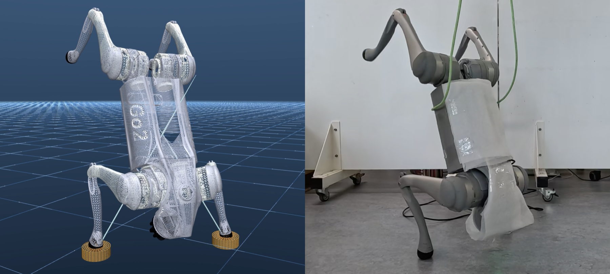

## Key Contributions

1. **Hybrid Bellman target with a characterized fixed point.** A regularized value target combining a real
   transition under the behavior policy $\beta$ with an imagined transition under $\pi_\theta$. We prove this
   composed operator is a $\gamma^2$-contraction with a unique fixed point $V_\text{CAST}$, corresponding to an
   alternating $\beta \rightarrow \pi_\theta$ process.
2. **Expanded $k$-step policy gradient.** Since a state-value critic has no action input to differentiate through, we
   reconstruct an action-value estimate from the learned reward and dynamics models, and propagate policy gradients
   through $k$ imagined steps before bootstrapping with $V_\psi$.

## Method

CAST builds on TD-MPC2, retaining its latent world model and MPPI planner, while replacing the action-value critic
$Q(z,a)$ with an ensemble state-value critic $V(z)$ trained toward the value of the planner-augmented behavior policy
$\beta$.

- **Action-value &rarr; state-value critic.** $Q(z,a)$ is replaced by an ensemble $V(z)$. The planner uses
  $\bar V_\psi(z_{t+H})$ directly as the terminal value, removing the need to sample a terminal policy action during
  MPPI.
- **Behavior-value target.** The critic is trained toward the alternating composition of $\beta$ and $\pi_\theta$
  instead of the value of $\pi_\theta$ alone, drawing on the stronger planner-augmented behavior policy.
- **Expanded policy gradient.** Since $V(z)$ has no action input to differentiate, gradients are propagated through
  $k$ imagined transitions of the learned dynamics before bootstrapping with $\bar V_\psi$, instead of a single
  $Q(z,\pi_\theta(z))$ step.

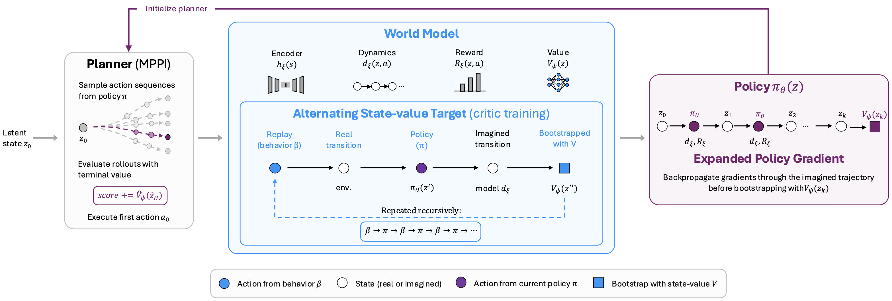

The behavior policy $\beta$ (the planner) generally outperforms the learned policy $\pi_\theta$, especially early in
training. We argue the critic should learn the value of $\beta$ rather than $\pi_\theta$, so that policy improvement
can draw on a stronger critic. But bootstrapping directly from $\beta$ destabilizes training with overly large policy
updates — a common RL failure mode. CAST resolves this with a regularized target that mixes one real transition
under $\beta$ with one imagined transition under $\pi_\theta$:

$$y_t = r_t + \gamma\Big[R_\xi(z_{t+1}, \tilde a_{t+1}) + \gamma\, \bar V_\psi(\tilde z_{t+2})\Big], \qquad
\tilde a_{t+1} \sim \pi_\theta(\cdot \mid z_{t+1})$$

Under fixed policies and exact dynamics, the resulting operator $\mathcal T_\text{CAST} = \mathcal T_\beta
\mathcal T_\pi$ is a $\gamma^2$-contraction admitting a unique fixed point $V_\text{CAST}$ — neither the value of
$\beta$ nor of $\pi_\theta$ alone, but the value induced by their alternating composition. A state-value critic also
removes the need to sample a terminal action during planning, and gradients for policy improvement are instead
propagated through $k$ imagined transitions of the learned dynamics before bootstrapping with $\bar V_\psi$.

## Results

CAST is evaluated on 14 high-dimensional continuous-control tasks from the DeepMind Control Suite and HumanoidBench
against five representative baselines — SAC, DreamerV3, TD-MPC2, BMPC, and BOOM.

- **14** DMControl + HumanoidBench tasks
- **764 ± 63** average return @ 1M steps (best of all methods)
- **1** real-world Go2 handstand deployment

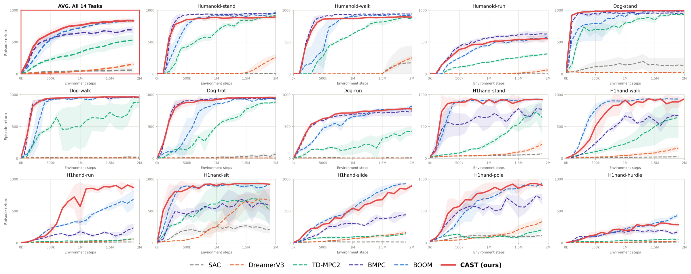

**Sample efficiency.** Episode return vs. environment steps for CAST against BOOM and BMPC (with SAC, DreamerV3, and
TD-MPC2 also shown) on 7 DMControl and 7 HumanoidBench tasks. CAST matches or exceeds baseline performance on the
majority of environments and consistently attains high returns earlier during training, most notably on
`H1hand-run`, `H1hand-pole`, and `Dog-run`.

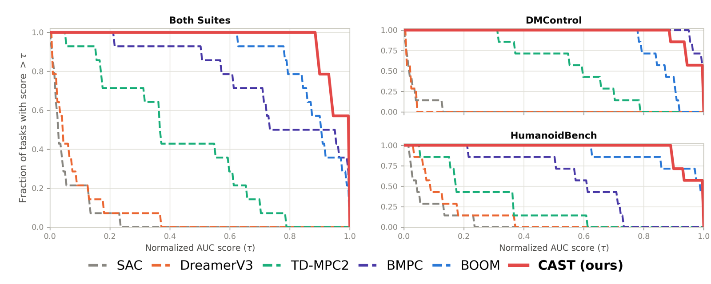

**Performance profile of AUC-to-2M scores**, normalized per task by the best AUC any method reaches on that task:
pooled across all 14 tasks, and per suite (DMControl, HumanoidBench). CAST achieves the best AUC performance profile
among all baselines, confirming that its improved learning dynamics translate into faster policy learning.

Example task rollouts, shown here as representative first frames (videos not hosted):

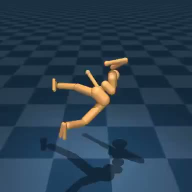
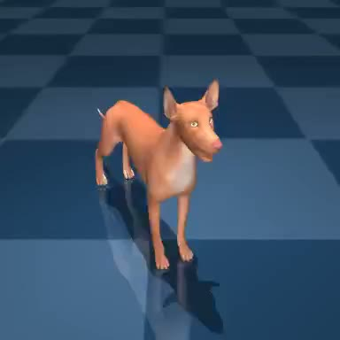
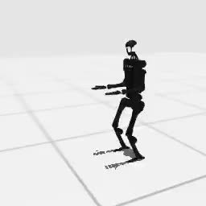

## Ablations

We isolate the contribution of the hybrid value target and the expanded policy-gradient horizon on Dog-run and
Humanoid-run.

1. **Value target.** The hybrid target beats both purely off-policy ($V_\beta$) and purely on-policy targets — pure
   off-policy bootstrapping destabilizes training.
2. **Behavior-to-policy ratio.** Anchoring to a single real transition under $\beta$ ($H_V{=}1$) before the imagined
   $\pi_\theta$ step is a well-balanced choice; $H_V{=}2,3$ do not consistently help.
3. **Gradient horizon.** $H_\pi{=}1$ holds a small lead over longer expanded-gradient horizons ($H_\pi{=}2,3$), with
   smaller confidence intervals on both tasks.

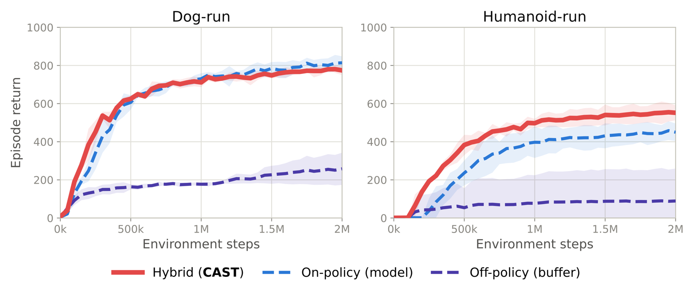

**Value-target ablation.** Our hybrid target vs. purely on-policy and purely off-policy alternatives ($H_\pi{=}1$
throughout). The purely off-policy variant (bootstrapping directly from $V_\beta$) is consistently the worst of the
three — it yields abrupt policy updates that destabilize learning, confirming the need for the alternating
construction.

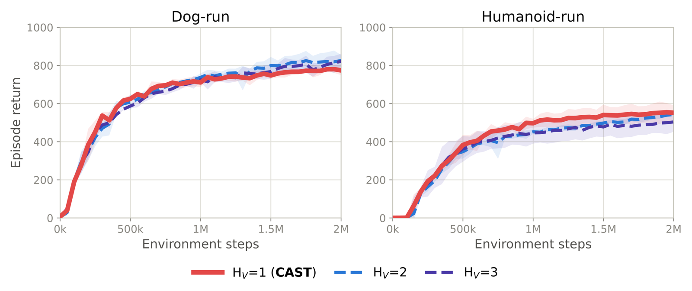

**Behavior-to-policy ratio ablation.** $H_V{=}1$ (CAST) vs. $H_V{=}2$ and $H_V{=}3$, i.e. anchoring the value target
to more real transitions under $\beta$ before the single imagined step under $\pi_\theta$. On Dog-run, $H_V{=}2,3$
remain competitive with $H_V{=}1$; on Humanoid-run both lag behind, indicating that anchoring to a single real
transition is a well-balanced choice.

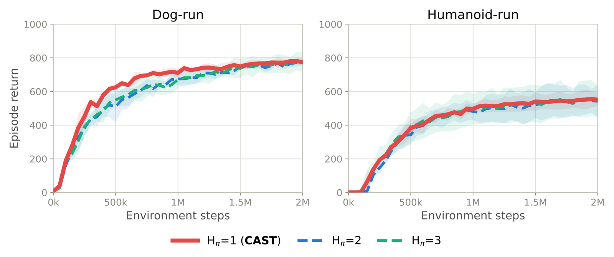

**Expanded-gradient-horizon ablation.** $H_\pi{=}1$ (ours) vs. $H_\pi{=}2$ and $H_\pi{=}3$, with the hybrid value
target fixed. Longer horizons track each other and $H_\pi{=}1$ closely, with $H_\pi{=}1$ holding a small lead and
smaller confidence intervals on both tasks.

## Policies Learned with CAST

CAST policies rolled out in the MuJoCo physics simulator, on both a quadruped (Unitree Go2, dynamic handstand) and a
humanoid (Unitree R1, locomotion), including robustness to external pushes applied during the handstand. Shown here
as representative first frames (videos not hosted):

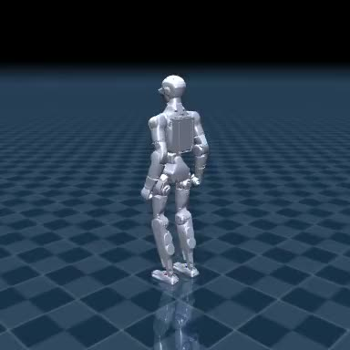
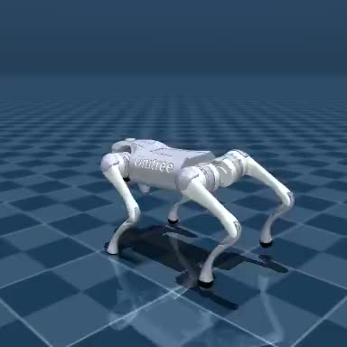
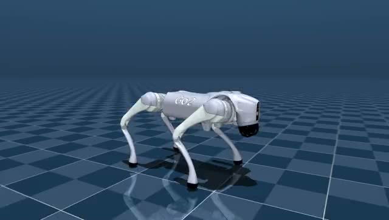

## Real-World Deployment

To demonstrate practical applicability, we deploy a policy trained entirely in simulation on a Unitree Go2 quadruped,
performing a dynamic handstand by lifting the rear legs and balancing on the front legs — trained with domain
randomization and a curriculum, and deployed directly without online planning. The policy transfers from simulation
to hardware and executes stable handstand motions in real time, without any online planning at deployment.

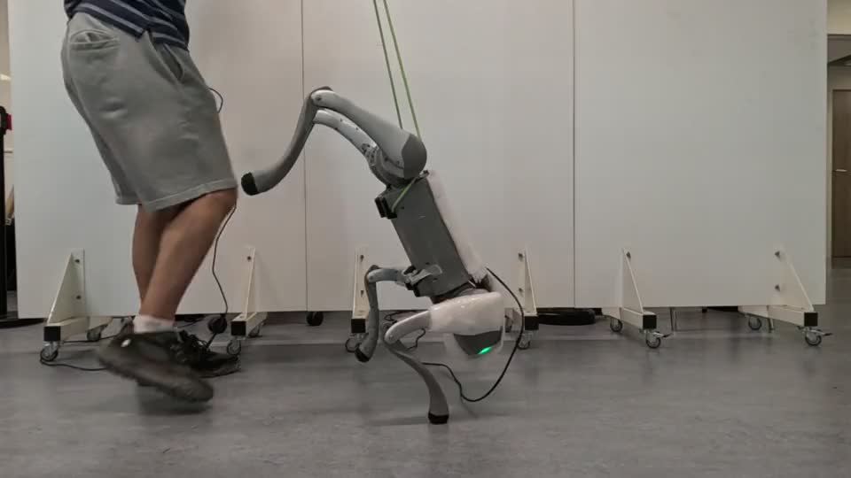
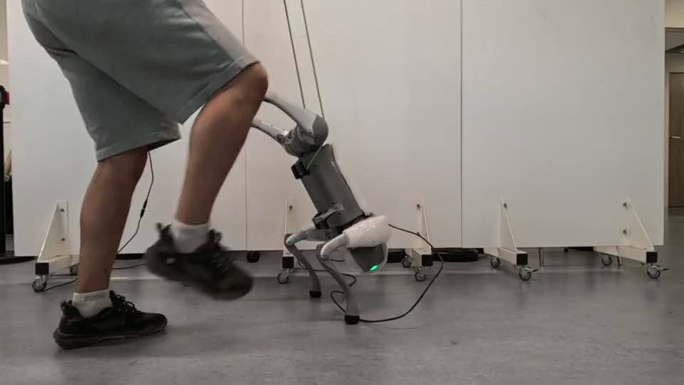

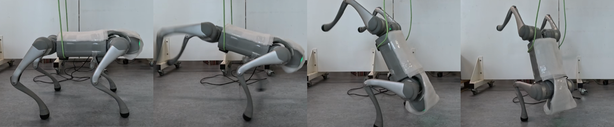
